  <picture><source media="(prefers-color-scheme: light)" srcset="./cards/hero-light.svg"></picture>

I build things that see, decide and respond: neural networks that read sign language, controllers that talk to sensors, and interfaces people actually enjoy using. Smart Technology student at Astana IT University, also leading product design in the AIS startup.

  <a href="https://github.com/Mkirik1"><picture><source media="(prefers-color-scheme: light)" srcset="./cards/quest-rsl-light.svg"></picture></a>
  <a href="https://github.com/Mkirik1/xzt-iiot"><picture><source media="(prefers-color-scheme: light)" srcset="./cards/quest-xzt-light.svg"></picture></a>
  <a href="https://github.com/Mkirik1"><picture><source media="(prefers-color-scheme: light)" srcset="./cards/quest-ais-light.svg"></picture></a>
  <a href="https://github.com/Mkirik1/menu"><picture><source media="(prefers-color-scheme: light)" srcset="./cards/quest-coffee-light.svg"></picture></a>
  <a href="https://github.com/Mkirik1"><picture><source media="(prefers-color-scheme: light)" srcset="./cards/quest-cargo-light.svg"></picture></a>
  <a href="https://github.com/Mkirik1"><picture><source media="(prefers-color-scheme: light)" srcset="./cards/quest-traffic-light.svg"></picture></a>
  <a href="https://github.com/hpns47/ieee-bss-ee-provenance-poc"><picture><source media="(prefers-color-scheme: light)" srcset="./cards/quest-land-light.svg"></picture></a>
  <a href="https://github.com/Mkirik1"><picture><source media="(prefers-color-scheme: light)" srcset="./cards/quest-shorts-light.svg"></picture></a>

  <picture><source media="(prefers-color-scheme: light)" srcset="./cards/achievements-light.svg"></picture>
  <picture><source media="(prefers-color-scheme: light)" srcset="./cards/journey-light.svg"></picture>
  <picture><source media="(prefers-color-scheme: light)" srcset="./cards/stats-light.svg"></picture>
  <picture><source media="(prefers-color-scheme: light)" srcset="./cards/activity-light.svg"></picture>

### Research

- **Context and Fairness-Aware Predictive Traffic Signal Control for Urban Intersections**. IEEE SIST 2026, co-author
- **Multi-Level Optical-Radar Correlation Decoupling Framework for Hidden Land Surface Change Detection**. IEEE SIST 2026, co-author
- **XZT-IIoT: Explainable Zero-Trust Access Control with Lightweight Blockchain Audit for Industrial IoT**. Paper in preparation

### Join my party

Open to freelance, full-time roles and research collaborations. [LinkedIn](https://linkedin.com/in/maxim-kirik) · m3495245@gmail.com

Cards are animated SVGs built by <code>scripts/build_cards.py</code> and refreshed daily by a GitHub Action. Fonts: Press Start 2P and VT323 (SIL Open Font License).
