  

I build things that see, decide and respond: neural networks that read sign language, controllers that talk to sensors, and interfaces people actually enjoy using. Smart Technology student at Astana IT University and CDO of the AIS team.

  
  
  
  
  
  
  
  

  
  
  
  

### Research

- **Context and Fairness-Aware Predictive Traffic Signal Control for Urban Intersections**. IEEE SIST 2026, co-author
- **Multi-Level Optical-Radar Correlation Decoupling Framework for Hidden Land Surface Change Detection**. IEEE SIST 2026, co-author
- **XZT-IIoT: Explainable Zero-Trust Access Control with Lightweight Blockchain Audit for Industrial IoT**. Paper in preparation

### Join my party

Open to freelance, full-time roles and research collaborations. [LinkedIn](https://linkedin.com/in/maxim-kirik) · m3495245@gmail.com

Cards are animated SVGs built by <code>scripts/build_cards.py</code> and refreshed daily by a GitHub Action. Fonts: Press Start 2P and VT323 (SIL Open Font License).
